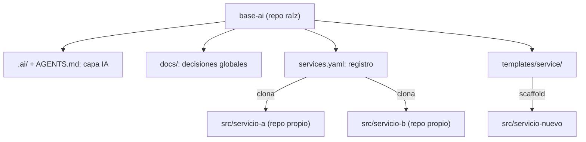

# base-ai

> Plantilla base, distribuida como **CLI generador**, para inicializar proyectos de software **escalables, impulsados e integrados por IA**.

`base-ai` no es un framework ni contiene código de aplicación. Define la **raíz** de un proyecto: la capa de IA (reglas, skills, prompts), la gobernanza (ADR/RFC) y un registro de servicios. Cada servicio o módulo vive en `src/<nombre>` como un **repositorio totalmente independiente**, con su propia arquitectura, infraestructura y pipelines.

---

## 🧭 Modelo



| Nivel | Responsabilidad | Repositorio |
|-------|-----------------|-------------|
| **Raíz** (`base-ai`) | Capa IA, convenciones, decisiones transversales, registro de servicios | Propio |
| **Servicio** (`src/<nombre>`) | Código, arquitectura, infraestructura, tests, CI/CD | Propio e independiente |

**Principios:**
- **Aislamiento total:** un servicio no depende del repo raíz para construirse ni para desplegarse. `src/` está en `.gitignore`.
- **Stack libre:** cada servicio elige su lenguaje, su arquitectura y su nube.
- **Una sola fuente de IA:** las reglas y skills se escriben una vez en `.ai/` y se exportan a cada agente.

---

## 📁 Estructura

```
base-ai/
├── AGENTS.md              # Reglas globales para agentes IA
├── .ai/prompts/           # Fuente única de prompts/skills
├── .agents/skills/        # Skills exportados (adr, rfc, runbook, review)
├── docs/
│   ├── architecture/{adrs,rfcs}/        # Decisiones transversales
│   └── operations/{runbooks,postmortems}/
├── services.yaml          # Registro de servicios (repo, rama)
├── templates/service/     # Plantilla para nuevos servicios
│   ├── .github/workflows/
│   ├── docs/…
│   ├── infrastructure/{modules,staging,production}/
│   └── tests/
└── src/                   # Servicios clonados (ignorado por git)
```

---

## 🚀 CLI

```bash
npx create-base-ai mi-proyecto            # inicializa la raíz (o: base-ai init mi-proyecto)
base-ai service new api                   # scaffold desde templates/service → src/api (git init)
base-ai service add web git@…/web.git     # registra en services.yaml y clona
base-ai service remove web [--purge]      # lo quita del manifiesto (y opcionalmente de src/)
base-ai sync                              # clona/actualiza (ff-only) todos los servicios
base-ai ai sync                           # exporta .ai/ a cada agente (raíz y servicios)
base-ai doctor                            # falla si los artefactos IA están desactualizados (CI)
```

Desarrollo del CLI: `cd cli && npm install && npm test`.

---

## 🤖 Agentes soportados

| Agente | Archivo(s) |
|--------|------------|
| Antigravity / Gemini | `AGENTS.md`, `.agents/skills/` |
| Claude Code | `CLAUDE.md`, `.claude/commands/` |
| Cursor | `.cursor/rules/*.mdc` |
| GitHub Copilot | `.github/copilot-instructions.md` |
| OpenAI Codex | `AGENTS.md` |

---

## 🗺️ Roadmap

- [x] Estructura raíz + plantilla de servicio
- [x] ADR-0001: arquitectura del CLI, manifiesto y fuente única de IA
- [x] `.ai/rules.md` y skills genéricos (adr, rfc, runbook, review)
- [x] CLI: `init`, `service new|add|remove`, `sync`, `ai sync`, `doctor` + CI
- [ ] Contenido adicional de `templates/service/` (p. ej. plantillas por stack)
- [ ] Publicación en npm (`base-ai` y paquete `create-base-ai`)

## 📄 Licencia

Por definir.
