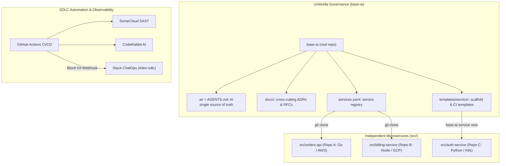
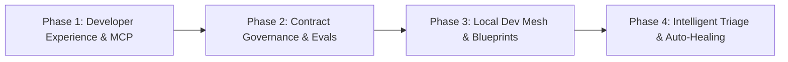

# base-ai

<p align="center">
  <a href="https://www.npmjs.com/package/@carlos17031691/base-ai"></a>
  <a href="https://github.com/carlos17031691/base-ai/actions/workflows/ci.yml"></a>
  <a href="https://sonarcloud.io/dashboard?id=carlos17031691_base-ai"></a>
  <a href="https://sonarcloud.io/dashboard?id=carlos17031691_base-ai"></a>
  <a href="https://coderabbit.ai"></a>
  <a href="https://slack.com"></a>
  <a href="LICENSE"></a>
</p>

> Enterprise-grade CLI scaffolding & governance for **scalable, AI-driven software architectures**.

`base-ai` is an umbrella governance framework. It contains no application code; instead, it establishes the **single source of truth** for your AI development layer (`.ai/`), cross-cutting architectural governance (ADRs/RFCs), strict SDLC quality gates, and automated ChatOps. Each service or module lives in `src/<name>` as a **fully independent Git repository** with its own stack, data, cloud infrastructure, and CI/CD pipelines.

---

## 🧭 System Architecture & Isolation Model



| Scope | Responsibility | Repository | Remote |
|-------|----------------|------------|--------|
| **Root (`base-ai`)** | AI rules/skills, governance (ADRs/RFCs), ChatOps & service registry | Umbrella Repo | Single origin |
| **Services (`src/<name>`)** | Domain logic, framework, database, infrastructure & CI/CD | Independent Repos | Dedicated remotes (`services.yaml`) |

---

## 🛡️ Non-Negotiable SDLC Governance & Quality Gates

Every change in `base-ai` and its services adheres to strict engineering rules:

1. **Ticket Traceability & Git Hygiene:**
   - Every change requires a valid Story/Epic/Task ID (e.g. `PROJ-123`, `BASE-008`, `#20`).
   - Feature branches must branch from `development` (e.g. `feat/PROJ-123-slug`). Direct pushes to `main`, `master`, or `development` are blocked by `.githooks/`.
2. **Dual Automated Quality Gates:**
   - **SonarQube™ / SonarCloud™:** Deterministic SAST, zero vulnerabilities, and $\ge 80\%$ test coverage.
   - **CodeRabbit™:** Automated AI cognitive review analyzing architecture boundaries, clean code, and security.
3. **Severity-Based Triage & Mandatory Human Approval:**
   - **High & Medium findings:** Must be fixed and re-verified in code before human approval.
   - **Low findings:** May merge without code modifications only if registered as technical debt (Project Issue).
   - **Human Sign-off:** Passing automated checks is a prerequisite; no PR can merge without explicit human review.
4. **Zero Unresolved Conversations Rule:**
   - All review comments and discussion threads raised by bots (CodeRabbit) or human peers must be verified and marked resolved before merge.
5. **ChatOps & Slack™ Integration:**
   - CI/CD pipelines broadcast structured Slack Block Kit notifications on:
     - 📋 **PR Opened / Reopened** with Ticket ID.
     - ✅ **PR Ready for Human Review** (after passing unit tests and SonarCloud).
     - 🚨 **CI / Quality Gate Failures** with direct links to workflow logs.
     - 🚀 **Production Releases** published to npm and GitHub.
   - Strict graceful degradation: skips silently without breaking CI if `SLACK_WEBHOOK_URL` is omitted.

---

## 🧩 19 Core Engineering Skills

Exported from `.ai/` into every AI coding assistant:

| Skill | Purpose |
|-------|---------|
| `discovery` | Turn raw ideas into MVP boundaries, candidate services, Epics & Gherkin User Stories (Jira, ClickUp, Trello) |
| `sdlc` | End-to-end engineering lifecycle & gates (Traceability → Branch → Design → Implement → Verify → Review → Release) |
| `architecture` | Domain isolation, Dependency Inversion, backward-compatible contracts & resilience patterns |
| `integrations` | External APIs, webhook signature verification, Slack ChatOps & resilient LLM gateways (OpenRouter, LiteLLM) |
| `ai-ops` | Model tiering, prompt prefix caching, token optimization & cost telemetry (AI FinOps) |
| `agents` | Tool-calling AI agents & MCP servers with least-privilege tools and Human-in-the-Loop guardrails |
| `workflows` | Workflow automation engines (n8n, Temporal, Inngest) with GitOps, versioning & idempotency |
| `memory` | Persistent cross-session project memory (`.ai/memory.md`) & AI app memory architectures |
| `rag` | Retrieval-Augmented Generation (chunking, embeddings, hybrid search, pre-retrieval ACLs & eval) |
| `database` | Zero-downtime database migrations (Expand-and-Contract), connection pooling & SQL/NoSQL tuning |
| `testing` | Test pyramid (unit, integration, cross-service contract tests) & deterministic AI Evals |
| `observability` | Structured JSON logging with `trace_id`, RED/USE metrics, `/healthz` + `/readyz`, and Monitoring as Code |
| `infrastructure` | Cloud IaC (OpenTofu, Terraform, Pulumi), keyless OIDC auth, GitOps PR `plan`→`apply` & immutable rollback |
| `security` | Threat modeling (STRIDE), OWASP security audits, secret scanning (GitGuardian) & input sanitization |
| `review` | PR review across traceability, clean code, architecture, security, and severity triage |
| `docs` | Service documentation, OpenAPI/AsyncAPI specifications & architecture blueprints |
| `adr` | Immutable Architecture Decision Records |
| `rfc` | Requests for Comments for high-impact or cross-service architectural shifts |
| `runbook` | On-call operational runbooks and disaster mitigation procedures |

---

## 🚀 CLI Quick Start

```bash
# 1. Initialize an umbrella root project
npx @carlos17031691/base-ai init my-project --ci github

# 2. Scaffold a new independent service with Cloud & IaC templates
base-ai service new orders-api git@github.com:myorg/orders-api.git --cloud gcp --iac opentofu

# 3. Register and clone an existing service
base-ai service add billing-svc git@github.com:myorg/billing-svc.git --branch main

# 4. Sync AI conventions across all assistants & clone all services
base-ai sync

# 5. Add persistent cross-session memory
base-ai memory add "Production deploys require staging validation first" --ticket PROJ-101 --tag ops

# 6. Hybrid context search across ADRs, RFCs, Runbooks & Contracts
base-ai context search "How do we handle database migrations?"

# 7. Validate project health & detect configuration drift in CI
base-ai doctor
```

---

## 🤖 Supported AI Agents & Ecosystem

`base-ai` syncs `.ai/` into native instruction files across all major coding assistants:

| Assistant / Platform | Generated File(s) |
|----------------------|-------------------|
| **Google Antigravity™ / Gemini™** | `AGENTS.md`, `.agents/skills/` |
| **Anthropic Claude Code™** | `CLAUDE.md`, `.claude/commands/` |
| **Cursor™** | `.cursor/rules/*.mdc` |
| **GitHub Copilot™** | `.github/copilot-instructions.md`, `.github/prompts/` |
| **OpenAI Codex™ / ChatGPT™** | `AGENTS.md` |

### 🔌 Model Context Protocol (MCP) Integration

`base-ai` includes a native [Model Context Protocol (MCP)](https://modelcontextprotocol.io/) server (`base-ai mcp`) running over standard `stdio` with zero external dependencies. It exposes project memory, hybrid context search, health diagnostics, token statistics, service catalogs, and architectural prompts directly to agentic workflows.

#### Claude Desktop (`claude_desktop_config.json`)
```json
{
  "mcpServers": {
    "base-ai": {
      "command": "npx",
      "args": ["-y", "@carlos17031691/base-ai", "mcp", "--root", "/absolute/path/to/your/project"]
    }
  }
}
```

#### Cursor (`.cursor/mcp.json`)
```json
{
  "mcpServers": {
    "base-ai": {
      "command": "npx",
      "args": ["-y", "@carlos17031691/base-ai", "mcp", "--root", "${workspaceFolder}"]
    }
  }
}
```

---

## 🗺️ Product Roadmap



### ✅ Completed Milestones
- [x] **ADR-0001:** CLI architecture, service manifest (`services.yaml`), and single AI source of truth (`.ai/`).
- [x] **ADR-0002:** Strict Git hooks, branch discipline (`development` staging), and mandatory ticket traceability.
- [x] **ADR-0003:** Runtime bootstrap, socket binding on `PORT`, `/healthz` + `/readyz`, and graceful `SIGTERM` shutdown.
- [x] **FinOps & AI Operations:** Multi-model priority cascade (`AI_MODELS`), quota rollover, and JSON schema prompt contracts.
- [x] **Automated Releases:** Continuous versioning, provenance-backed npm publishing, and GitHub Releases.
- [x] **Dual Quality Gates:** SonarCloud™ SAST ($\ge 80\%$ test coverage, zero vulnerabilities) & CodeRabbit™ AI cognitive review.
- [x] **PR Review Governance:** Severity-based triage (High/Medium blockers vs. Low tech debt) with mandatory human approval.
- [x] **Zero Unresolved Discussions:** Strict blocker rule requiring all review comments to be resolved before merge.
- [x] **ChatOps Integration:** Automated Slack® Block Kit notifications for PR lifecycle, quality gates, CI failures, and releases.
- [x] **[#22](https://github.com/carlos17031691/base-ai/issues/22) Native Model Context Protocol (MCP) Server (`base-ai mcp`):** Zero-dependency stdio server exposing memory, context search, doctor health checks, token FinOps, service catalogs, and SDLC prompts.

---

### 🚀 Upcoming Horizons

#### 🟢 Phase 1: Developer Experience & Model Context Protocol (Short-Term)
- [ ] **[#23](https://github.com/carlos17031691/base-ai/issues/23) Interactive Terminal UI Wizard (`base-ai wizard`):** Interactive prompt for scaffolding projects, selecting stacks (Node, Python, Go, Rust), cloud providers, and CI/CD targets.
- [ ] **[#24](https://github.com/carlos17031691/base-ai/issues/24) CI Token Budget FinOps Guardrail (`base-ai ai stats`):** Enforce hard token and cost ceilings in CI to prevent prompt bloat and uncontrolled API spend.

#### 🟡 Phase 2: Contract Governance & AI Evals (Mid-Term)
- [ ] **[#25](https://github.com/carlos17031691/base-ai/issues/25) Automated API Breaking Change Detection (Contract Testing Gate):** Automated semantic diffing (`oasdiff` / `buf break`) on OpenAPI and gRPC schemas in PRs to block unversioned contract breaks across services.
- [ ] **[#26](https://github.com/carlos17031691/base-ai/issues/26) Deterministic AI Evaluation Suite (`base-ai eval`):** Automated regression testing for prompts, tools, and RAG pipelines (faithfulness, precision, recall, and hallucination rate) directly in CI.

#### 🔵 Phase 3: Local Dev Mesh & Polyglot Blueprints (Long-Term)
- [ ] **[#27](https://github.com/carlos17031691/base-ai/issues/27) Multi-Service Local Dev Mesh (`base-ai dev`):** Dynamic Docker Compose generation orchestrating all services in `services.yaml` with hot reloading and mock cloud/AI dependencies.
- [ ] **[#28](https://github.com/carlos17031691/base-ai/issues/28) Specialized Service Blueprint Catalog:** Production-ready templates including `FastAPI + UV`, `Go + Gin/sqlc`, `RAG + pgvector/hybrid search`, and `MCP Server`.

#### 🟣 Phase 4: Intelligent Operations & Self-Healing (Vision)
- [ ] **[#29](https://github.com/carlos17031691/base-ai/issues/29) Intelligent Incident Triage & Automated Postmortems (`base-ai triage`):** Ingest production tracebacks or Sentry alerts, match them semantically against ADRs and Runbooks, and generate mitigation guidance and blameless postmortems.

---

## 📄 License & Trademarks

Licensed under the [MIT License](LICENSE).

### Trademarks & Attributions
All product names, logos, brands, and registered trademarks mentioned in this documentation and repository are property of their respective owners:
- **GitHub®**, **GitHub Actions®**, and **GitHub Copilot®** are registered trademarks of GitHub, Inc.
- **Slack®** is a registered trademark of Slack Technologies, LLC / Salesforce, Inc.
- **SonarQube™** and **SonarCloud™** are trademarks of SonarSource SA.
- **CodeRabbit™** is a trademark of CodeRabbit, Inc.
- **GitGuardian®** is a registered trademark of GitGuardian SAS.
- **Google®** and **Gemini™** are trademarks of Google LLC.
- **Claude™** is a trademark of Anthropic PBC.
- **Cursor™** is a trademark of Anysphere, Inc.
- **OpenAI®** and **ChatGPT®** are registered trademarks of OpenAI, Inc.
- **OpenTofu™** is a trademark of the Linux Foundation.
- **Terraform®** is a registered trademark of HashiCorp / IBM.

Use of these marks does not imply any affiliation, sponsorship, or endorsement.
