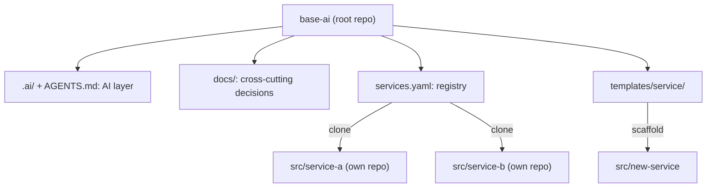

# base-ai

> Generic CLI scaffolding for **scalable, AI-driven software projects**.

`base-ai` is not a framework and contains no application code. It defines the **root** of a project: the AI layer (rules, skills), cross-cutting governance (ADRs/RFCs) and a service registry. Each service or module lives in `src/<name>` as a **fully independent repository**, with its own stack, architecture, infrastructure and CI/CD.

---

## 🧭 Model



| Level | Responsibility | Repository |
|-------|----------------|------------|
| **Root** (`base-ai`) | AI layer, conventions, cross-cutting decisions, service registry | Own |
| **Service** (`src/<name>`) | Code, architecture, infrastructure, tests, CI/CD | Own and independent |

**Principles:**
- **Full isolation & own repository:** every service in `src/<name>` has its own remote Git repository (`repo` in `services.yaml`) and never depends on the root repo to build, test or deploy. `src/` is git-ignored.
- **Mandatory ticket traceability & PR-only workflow:** every change inside `src/<name>` must be tied to a Story/Epic/Task (Jira, ClickUp, Trello, etc.), committed on a working branch (e.g. `feat/PROJ-123-slug`) with the ticket ID in the commit message, and merged via **Pull Request** — direct commits or pushes to `main`, `master` or `development` are blocked by `.githooks/`.
- **Stack- and platform-agnostic:** each service chooses its language, architecture, cloud and CI provider.
- **Single AI source of truth:** rules and skills are written once in `.ai/` and exported to every agent.
- **Built-in engineering standards:** SDLC gates, Clean Code (SOLID, KISS, YAGNI), decoupled architecture (Dependency Inversion, explicit contracts, resilience) and Security by Design (OWASP, STRIDE, zero secrets).

---

## 🧩 Core skills

| Skill | Purpose |
|-------|---------|
| `sdlc` | End-to-end engineering workflow & quality gates (requirements → design → code → test → review → operate) |
| `architecture` | Stack-agnostic service design (domain isolation, dependency inversion, contracts, resilience) |
| `security` | Threat modeling (STRIDE) and OWASP security audit |
| `review` | Code/PR review across correctness, clean code, architecture, security and SDLC |
| `adr` | Immutable Architecture Decision Records |
| `rfc` | Request for Comments for high-impact or cross-service changes |
| `runbook` | On-call operational runbooks |

---

## 📁 Layout

```
base-ai/
├── AGENTS.md              # Global rules for AI agents (generated)
├── .ai/                   # Single AI source of truth (rules, config, skills)
├── .agents/skills/        # Exported skills (adr, rfc, runbook, review, architecture, security, sdlc)
├── docs/
│   ├── architecture/{adrs,rfcs}/        # Cross-cutting decisions
│   └── operations/{runbooks,postmortems}/
├── services.yaml          # Service registry (repo, optional branch)
├── templates/service/     # Minimal, stack-neutral service template
└── src/                   # Cloned services (git-ignored)
```

---

## 🚀 CLI

```bash
npx create-base-ai my-project [--ci none|github|gitlab]   # initialise the root (or: base-ai init my-project)
base-ai service new api <repo> [--template service]       # scaffold templates/service → src/api (own repo + git hooks)
base-ai service add web <repo> [--branch main]            # register in services.yaml, clone & install git hooks
base-ai service remove web [--purge]                      # remove from manifest (and optionally delete src/web)
base-ai sync                                              # clone/fast-forward all services, install hooks & ai sync
base-ai ai sync                                           # export .ai/ to every agent (root and services)
base-ai doctor                                            # validate services.yaml & fail if AI artefacts drift (CI)
```

CLI development: `cd cli && npm install && npm test`.

---

## 🤖 Supported agents

| Agent | Generated file(s) |
|-------|-------------------|
| Antigravity / Gemini | `AGENTS.md`, `.agents/skills/` |
| Claude Code | `CLAUDE.md`, `.claude/commands/` |
| Cursor | `.cursor/rules/*.mdc` |
| GitHub Copilot | `.github/copilot-instructions.md`, `.github/prompts/` |
| OpenAI Codex | `AGENTS.md` |

---

## 🗺️ Roadmap

- [x] Root layout + minimal service template
- [x] ADR-0001: CLI architecture, manifest and single AI source
- [x] English `.ai/rules.md` and generic skills (`adr`, `rfc`, `runbook`, `review`)
- [x] CLI: `init`, `service new|add|remove`, `sync`, `ai sync`, `doctor`
- [ ] Publish to npm (`base-ai` and `create-base-ai`)

## 📄 License

TBD.
