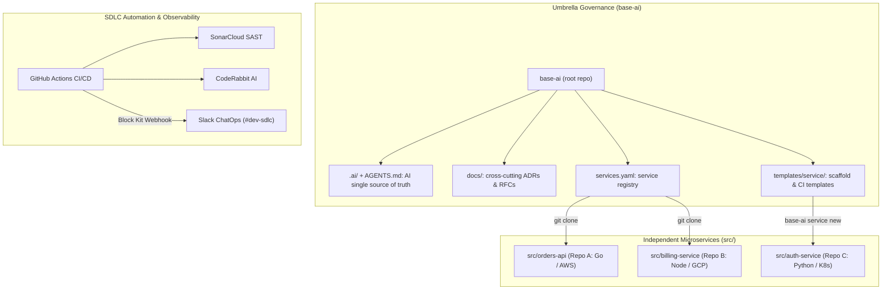
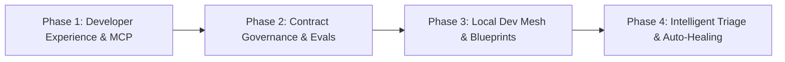

# base-ai

<p align="center">
  <a href="https://www.npmjs.com/package/@carlos17031691/base-ai"></a>
  <a href="https://github.com/carlos17031691/base-ai/actions/workflows/ci.yml"></a>
  <a href="https://sonarcloud.io/dashboard?id=carlos17031691_base-ai"></a>
  <a href="https://sonarcloud.io/dashboard?id=carlos17031691_base-ai"></a>
  <a href="https://coderabbit.ai"></a>
  <a href="https://slack.com"></a>
  <a href="LICENSE"></a>
</p>

> Enterprise-grade CLI scaffolding & governance for **scalable, AI-driven software architectures**.

`base-ai` is an umbrella governance framework. It contains no application code; instead, it establishes the **single source of truth** for your AI development layer (`.ai/`), cross-cutting architectural governance (ADRs/RFCs), strict SDLC quality gates, and automated ChatOps. Each service or module lives in `src/<name>` as a **fully independent Git repository** with its own stack, data, cloud infrastructure, and CI/CD pipelines.

---

## 🧭 System Architecture & Isolation Model



| Scope | Responsibility | Repository | Remote |
|-------|----------------|------------|--------|
| **Root (`base-ai`)** | AI rules/skills, governance (ADRs/RFCs), ChatOps & service registry | Umbrella Repo | Single origin |
| **Services (`src/<name>`)** | Domain logic, framework, database, infrastructure & CI/CD | Independent Repos | Dedicated remotes (`services.yaml`) |

---

## 🛡️ Non-Negotiable SDLC Governance & Quality Gates

Every change in `base-ai` and its services adheres to strict engineering rules:

1. **Ticket Traceability & Git Hygiene:**
   - Every change requires a valid Story/Epic/Task ID (e.g. `PROJ-123`, `BASE-008`, `#20`).
   - Feature branches must branch from `development` (e.g. `feat/PROJ-123-slug`). Direct pushes to `main`, `master`, or `development` are blocked by `.githooks/`.
2. **Dual Automated Quality Gates:**
   - **SonarQube™ / SonarCloud™:** Deterministic SAST, zero vulnerabilities, and $\ge 80\%$ test coverage.
   - **CodeRabbit™:** Automated AI cognitive review analyzing architecture boundaries, clean code, and security.
3. **Severity-Based Triage & Mandatory Human Approval:**
   - **High & Medium findings:** Must be fixed and re-verified in code before human approval.
   - **Low findings:** May merge without code modifications only if registered as technical debt (Project Issue).
   - **Human Sign-off:** Passing automated checks is a prerequisite; no PR can merge without explicit human review.
4. **Zero Unresolved Conversations Rule:**
   - All review comments and discussion threads raised by bots (CodeRabbit) or human peers must be verified and marked resolved before merge.
5. **ChatOps & Slack™ Integration:**
   - CI/CD pipelines broadcast structured Slack Block Kit notifications on:
     - 📋 **PR Opened / Reopened** with Ticket ID.
     - ✅ **PR Ready for Human Review** (after passing unit tests and SonarCloud).
     - 🚨 **CI / Quality Gate Failures** with direct links to workflow logs.
     - 🚀 **Production Releases** published to npm and GitHub.
   - Strict graceful degradation: skips silently without breaking CI if `SLACK_WEBHOOK_URL` is omitted.

---

## 🧩 20 Core Engineering Skills

Exported from `.ai/` into every AI coding assistant:

| Skill | Purpose |
|-------|---------|
| `discovery` | Turn raw ideas into MVP boundaries, candidate services, Epics & Gherkin User Stories (Jira, ClickUp, Trello) |
| `sdlc` | End-to-end engineering lifecycle & gates (Traceability → Branch → Design → Implement → Verify → Review → Release), with the pipeline agent and task state for each gate |
| `architecture` | Domain isolation, Dependency Inversion, backward-compatible contracts & resilience patterns |
| `integrations` | External APIs, webhook signature verification, Slack ChatOps & resilient LLM gateways (OpenRouter, LiteLLM) |
| `ai-ops` | Model tiering, prompt prefix caching, token optimization & cost telemetry (AI FinOps) |
| `agents` | Tool-calling AI agents & MCP servers with least-privilege tools and Human-in-the-Loop guardrails |
| `workflows` | Workflow automation engines (n8n, Temporal, Inngest) with GitOps, versioning & idempotency |
| `memory` | Persistent cross-session project memory (`.ai/memory.md`) & AI app memory architectures |
| `rag` | Retrieval-Augmented Generation (chunking, embeddings, hybrid search, pre-retrieval ACLs & eval) |
| `database` | Zero-downtime database migrations (Expand-and-Contract), connection pooling & SQL/NoSQL tuning |
| `testing` | Test pyramid (unit, integration, cross-service contract tests) & deterministic AI Evals |
| `observability` | Structured JSON logging with `trace_id`, RED/USE metrics, `/healthz` + `/readyz`, and Monitoring as Code |
| `infrastructure` | Cloud IaC (OpenTofu, Terraform, Pulumi), keyless OIDC auth, GitOps PR `plan`→`apply` & immutable rollback |
| `security` | Threat modeling (STRIDE), OWASP security audits, secret scanning (GitGuardian) & input sanitization |
| `review` | PR review across traceability, clean code, architecture, security, and severity triage |
| `pipeline` | Multi-agent pipeline protocol: task state machine, the agent that owns each transition, per-role reads & writes, locked plans & escalation to the human |
| `docs` | Service documentation, OpenAPI/AsyncAPI specifications & architecture blueprints |
| `adr` | Immutable Architecture Decision Records |
| `rfc` | Requests for Comments for high-impact or cross-service architectural shifts |
| `runbook` | On-call operational runbooks and disaster mitigation procedures |

---

## 🚀 CLI Quick Start

```bash
# 1. Initialize an umbrella root project
npx @carlos17031691/base-ai init my-project --ci github

# 2. Scaffold a new independent service with Cloud & IaC templates
base-ai service new orders-api git@github.com:myorg/orders-api.git --cloud gcp --iac opentofu

# 3. Register and clone an existing service
base-ai service add billing-svc git@github.com:myorg/billing-svc.git --branch main

# 4. Sync AI conventions across all assistants & clone all services
base-ai sync

# 5. Add persistent cross-session memory
base-ai memory add "Production deploys require staging validation first" --ticket PROJ-101 --tag ops

# 6. Hybrid context search across ADRs, RFCs, Runbooks & Contracts
base-ai context search "How do we handle database migrations?"

# 7. Validate project health & detect configuration drift in CI
base-ai doctor

# 8. Interactive guided setup (wizard)
base-ai wizard

# 9. Token budget guardrail in CI (exit 1 on violations)
#    Also reports each role definition in .claude/agents/ and its reference files in
#    .claude/agents/<role>/ (chars, estimated tokens, totals) and fails when one exceeds its
#    budget in .ai/config.yaml (budgets.definitions, budgets.definition_totals)
base-ai ai stats --max-tokens 5000 --ci

# 10. Run AI eval suites (deterministic + LLM-as-judge)
base-ai eval --ci

# 11. Start local dev mesh (Docker Compose from services.yaml)
base-ai dev
base-ai dev --service api
base-ai dev stop
base-ai dev status

# 12. Check a pipeline task directory (read-only; exit 1 names each failed check)
base-ai pipeline check .ai/tasks/PROJ-123 [--json] [--root <dir>]
# 13. Check To register keys against GitHub issues (opt-in network; exit 0 registered, 1 missing, 2 could not check)
base-ai pipeline debt .ai/tasks/PROJ-123 [--issues <n,…>] [--json] [--root <dir>]
# 14. Record a Claude Code run's token usage (SubagentStop/Stop hook; reads the payload on stdin; always exit 0)
#     The hook is written into .claude/settings.json by `ai sync` when usage.hook is claude-code
base-ai usage record [--root <dir>]
# 15. Show a task's recorded tokens per agent and model, with USD cost or "no price" (read-only, offline)
base-ai usage report .ai/tasks/PROJ-123 [--json] [--root <dir>]
# 16. Serve the pipeline HUD and JSON API over .ai/tasks/ on 127.0.0.1 (default port 4747; reads only, except the opt-in CHECK REGISTRATION with gh; Ctrl+C to stop)
#     The HUD's "open" links use dashboard.editor_url in .ai/config.yaml (default vscode://file/{path})
base-ai dashboard [--port N] [--root <dir>]
```

### 🧑‍🤝‍🧑 Multi-agent pipeline

- **New projects:** `init` ships the six role definitions in `.claude/agents/` (`planner`, `implementer`, `reviewer`, `qa`, `supervisor`, `improvement`), their reference files in `.claude/agents/<role>/`, the task state machine in `docs/task-state-machine.md` and the task templates in `templates/task/`. The root `.claude/agents/*.md` and `.claude/agents/<role>/*.md` files are editable source (see ADR-0004 and ADR-0005). Every role definition carries a `tools:` list in its frontmatter, so each role gets only the tools it names (least privilege, and less context per run).
- **Reference files:** a definition may move passages that a run needs only in a given case into reference files, `.claude/agents/<role>/<name>.md` (no frontmatter, one level deep). They are part of that definition and bind exactly as it does; the definition names each one as `.claude/agents/<role>/<name>.md` and says when to read it. `ai stats` and `ai sync` fail, naming the path, on a reference file its definition does not name and on a directory under `.claude/agents/` with no definition. `qa` has three: `.claude/agents/qa/halt.md`, `execution-anomalies.md` and `base-choice.md`. `reviewer` has three: `.claude/agents/reviewer/halt.md`, `base-choice.md` and `re-review.md`. `supervisor` has four: `.claude/agents/supervisor/decisions-format.md`, `registration-match.md`, `steering.md` and `refusal-halt-forms.md`.
- **Definition budgets:** `ai stats` (plain and `--ci`) measures each role definition as a whole file, frontmatter included, and each of its reference files (chars and estimated tokens; the definition total with its reference files; the sums over all roles). It enforces two maps of role to a maximum number of estimated tokens in `.ai/config.yaml`: `budgets.definitions` (the definition file alone) and `budgets.definition_totals` (the definition plus its reference files; a role with reference files and no total is held to its `definitions` value), so text moved into a reference file still counts. It exits 1, naming the role and both numbers, when a definition or a total is above its budget or a definition has no entry in `budgets.definitions`; this applies with or without `--max-tokens`. A project with no `budgets` key gets the report and no violation. The `qa` budgets are 14,500 for `qa.md` (down from 19,750) and 18,250 with its reference files; the `reviewer` budgets are 6,000 for `reviewer.md` (down from 7,250) and 7,000 with its reference files; the `supervisor` budgets are 8,750 for `supervisor.md` (down from 11,500) and 11,250 with its reference files; the `improvement` budget is 8,000 for `improvement.md` (down from 9,000); each is the measured size rounded up to the next 250. To raise a budget, change the role's value in `.ai/config.yaml` through a PR whose approved plan says so.
- **Slimming a definition without weakening it:** `cd cli && npm run check:relocation -- <base-commit> <role> [--map <file>]` compares the definition and its reference files with the definition at a base commit and writes nothing. Without `--map` every base line must still be present, in the core or a reference file, in its original order; only the listed added lines are new. With `--map`, a JSON object `{ "base", "role", "ranges", "entries" }` whose `base` and `role` must match the arguments and whose `entries` are `{ "deleted", "carriers", "where" }` (all required), a base line may also be deleted when it is a list item inside `ranges` and its entry names the carrier lines, still in the core definition, that state the same rule; the reviewer judges each pair. The bare array form of BASE-079-T2 is accepted only for `qa` at `47ead24`. ADR-0005 records the method.
- **Checking a task directory:** `base-ai pipeline check <task-dir> [--json] [--root <dir>]` reads a task's files, writes nothing and exits 0 only when no check fails; a relative `<task-dir>` resolves against `--root`. It runs 18 checks (K1 `status.parse` to K18 `decisions.covers`; list and accepted forms in `docs/task-state-machine.md`) by the rules of `supervisor.md@682c6e4`, applied to every directory, and lists each `To register` key with its `file:line`. K17 `decisions.format` checks the `decisions.md` blocks and K18 `decisions.covers` checks that every post-lock event is covered. Registration is a separate, opt-in network command: `base-ai pipeline debt <task-dir> [--issues <n,…>] [--json] [--root <dir>]` looks each key up as `[<key>]` in GitHub issues with `gh` (60-second timeout per call, at most 60 `gh` calls) and exits 0 when every key is registered, 1 when one is missing, and 2 when it could not check, which it never treats as registered. It also reports who acts next as `facts.nextActor = { role, round?, reason }` and a `next: <role>[ round <n>] — <reason>` text line (JSON stays `schema: 1`), following the "Who acts next" table of `.ai/skills/pipeline/skill.md`: `role` is `planner`, `implementer`, `reviewer`, `qa`, `supervisor`, `human` or `none`, and `round` is present only for `reviewer` and `qa`. A failing integrity check gives `human` naming the first such check; failures that only mean work is still to do (for example K4 before `completed`, or K8 with no review round yet) count as progress instead, as listed in `docs/task-state-machine.md`. Send-backs and the supervisor's own ticket go to `human`, and `validated` gives `none`. Neither command checks steering or the branch, and no agent reads their output, `nextActor` included, yet (planned in #71).
- **Services:** `ai sync` exports the definitions and their reference files to every service with `ai: inherit` and Claude enabled, as generated files in `src/<name>/.claude/agents/`, checked by `doctor`. Services do not yet get the state-machine doc or the task templates (follow-up).
- **Token usage:** `base-ai usage record [--root <dir>]` runs as a Claude Code `SubagentStop` and `Stop` hook, which `ai sync` sets up (next bullet). It reads the hook payload on stdin and the transcript it names (only under `$CLAUDE_CONFIG_DIR/projects`, else `~/.claude/projects`), and appends one `UsageRecord` per model (counters and ids only; no prompt or response text is stored) to `.ai/tasks/<ticket>/usage.jsonl`. The ticket is `BASE_AI_TICKET` when it names an existing task directory (attribution `env`), else the longest `-`-prefix of the branch's last segment that does (`branch`), else the record goes to `.ai/usage/unattributed.jsonl` (`none`). Each assistant `message.id` counts once, and a per-session high-water mark (the last recorded message id) means a repeated hook never counts a message twice. `Stop` records role `coordinator`; `SubagentStop` records the subagent type, else the agent of the ticket's latest `status.json` transition, else `unknown`. It always exits 0, prints nothing on stdout, and on failure writes one `base-ai usage: <reason>` line to stderr and nothing else, an uncaught exception included.
- **Usage hook setup:** `usage.hook` in `.ai/config.yaml` is `claude-code` or `none` (absent means `none`; any other value fails `ai sync`, `ai stats` and `doctor`, naming the key). The root sets `claude-code`; `init` sets `none` in new projects, so opting in is one line plus `ai sync`. With `claude-code`, `ai sync` removes any generated hook from every event, including one left under another event, then writes one generated group into each of `hooks.SubagentStop` and `hooks.Stop` of the root's `.claude/settings.json` (created with only `hooks` when missing); with `none` it removes the generated hooks, any group, event or `hooks` object that removal left empty, and the file when nothing else is left. A hook is generated when its command contains `generated by base-ai`; every other key, group and hook is kept in order, though the file is re-serialised with two-space indentation on the first write. It is written only when it changes, and it is never listed in the generated-artefact lock. With `claude-code`, or when the file's text contains `generated by base-ai` anywhere (in a command or not), a file that is not a JSON object with a `hooks` object of arrays makes `ai sync` fail naming it, before it writes any artefact. With `none` (or `usage` absent), a file whose text does not contain `generated by base-ai` is left alone: it is neither parsed nor rewritten, and `doctor` does not report it. The command is `node "$CLAUDE_PROJECT_DIR/<cli>" usage record --root "$CLAUDE_PROJECT_DIR" # generated by base-ai`, where `<cli>` is `cli/dist/index.js` when `cli/package.json` is base-ai's own and `node_modules/@carlos17031691/base-ai/dist/index.js` otherwise. It needs `node` on PATH and a built CLI at that path (`npm --prefix cli run build`, or base-ai as a devDependency), not `base-ai` on PATH; a missing CLI shows as a non-blocking hook error. Claude Code reads hooks at session start, so restart it after the first sync. Only the root is configured; services are not (yet). `doctor` reports `root: usage hook missing in .claude/settings.json (run: base-ai ai sync)` when the hook is enabled and an event has no generated hook, `usage hook stale` when a generated hook differs from the expected command, appears twice, sits under another event or exists while `usage.hook` is `none` (`ai sync` removes or replaces it in each case), and `root: .claude/settings.json is not valid JSON settings (fix it, then run: base-ai ai sync)` when the file does not parse as above and the hook is `claude-code` or the file's text contains `generated by base-ai`; each makes `doctor` exit 1.
- **Pricing and `usage report`:** `usage.pricing` maps an exact model id (as recorded; no aliases or prefixes) to `{ input, cache_write, cache_read, output }`, in USD per million tokens. All four keys are required, each a number >= 0, and unknown keys are refused. There are no default prices; `.ai/config.yaml` carries a commented example. This repo's own `.ai/config.yaml` also sets a dated price for `claude-opus-5-5` (API-equivalent list prices, not a subscription bill), but `init` removes `usage.pricing` from the copied config (keeping its comments), so new projects still have no default prices. Cost is computed on read and never stored in `usage.jsonl`: `(input_tokens × input + cache_creation_input_tokens × cache_write + cache_read_input_tokens × cache_read + output_tokens × output) / 1e6`, rounded once to 4 decimals (half away from zero). A model with no price shows its tokens and `no price`, never 0; a total sums the priced records and adds `(+1 record with no price)` for one such record and `(+<n> records with no price)` for more. `base-ai usage report <task-dir> [--json] [--root <dir>]` reads `<task-dir>/usage.jsonl` (a relative path resolves against `--root`; a symlinked `usage.jsonl` is refused, while a symlinked task directory is followed), skips and counts unreadable lines, and prints one line per agent and model in order of first appearance, then a total; a missing or empty file prints `no usage data`, and a missing task directory exits 1. `--json` gives `{ "schema": 1, "ticket", "records", "skipped_lines", "groups", "total" }`, with `cost_usd` a number or `null` and `unpriced_records`.
- **Dashboard:** `base-ai dashboard [--port N] [--root <dir>]` starts a local `node:http` server that reads only, except for the opt-in registration check below, bound to `127.0.0.1` only (no `--host` flag, no IPv6 or `0.0.0.0` fallback) and prints `base-ai dashboard: http://127.0.0.1:<port>/ (Ctrl+C to stop)`. `--port` is a decimal integer from 0 to 65535, default 4747; 0 binds an ephemeral port and the printed URL shows the real one. Any other value, a root without `.ai/` or a bad `usage` or `dashboard` section in `.ai/config.yaml` exits 1. A busy port exits 1 with `base-ai dashboard: port <port> is in use (choose another with --port <n>)`; any other listen error exits 1 with `base-ai dashboard: cannot listen on 127.0.0.1:<port> (<code>)`. SIGINT or SIGTERM closes the file watchers, ends the open event streams, stops listening, closes open connections, prints `base-ai dashboard: stopped` on stderr and exits 0. It writes nothing and adds no dependency. Its only outbound call is the registration check below (`git` and `gh`, opt-in by button); nothing else leaves its own listener. Routes, `GET` or `HEAD` only, with one exception (`POST /api/tasks/<id>/registration`): `/healthz` gives `{"status":"ok"}`; `/api/tasks` gives `{ "schema": 1, "tasks", "skipped" }`, one entry per task with `id`, `ticket`, `title` (the text after `# Plan: <ticket> — ` on the first line of `plan.md`, with backticks and control characters removed and cut to 80 characters; `null` with no plan or no match), `state`, `ok`, `problem` (K1's detail when `status.json` is not accepted), `nextActor`, `review` and `qa` rounds and verdicts, `updated_at`, `tokens` (the `usage report` total, with `cost_usd`; zero records when `usage.jsonl` is missing) and `usage_error` (with `tokens: null`: the reader's message when `usage.jsonl` is a symlink, over 50 MiB or not a regular file, or `.ai/tasks/<id>/usage.jsonl cannot be read (<code>)` for another read error, such as `EACCES`, with no absolute path); `/api/tasks/<id>` gives that task's `title`, `files` (`{ name, path, present }` for `status.json`, `plan.md`, `review-report.md`, `qa-report.md` and `decisions.md`, with absolute paths and never their text), `transitions`, the 18 checks, `facts`, the `To register` keys with `file` and `line` (their registration status comes from the separate route below), `taskDir` and its usage records, each with `cost_usd` (`null`, never 0, for a model with no price); `/api/meta` gives `{ "schema": 1, "editorUrl" }`; `POST /api/tasks/<id>/registration` runs the `pipeline debt` check (the same code, its 60-call cap and its 60 s per call) for that task on demand, and `GET` or `HEAD` on the same path reads the last result, kept in memory per task (never written to disk, dropped when the task is no longer listed and cleared on stop), or `{"schema":1,"checkedAt":null}` before any check. The POST must carry `X-Base-AI: 1`, which a cross-site form or `` cannot send and a cross-origin `fetch` cannot send without a CORS preflight that is never granted; otherwise 403 `{"error":"missing X-Base-AI header"}`. A present `Origin` must be `http://127.0.0.1:<port>` or `http://localhost:<port>` and a present `Sec-Fetch-Site` must be `same-origin`, otherwise 403 `{"error":"cross-site request refused"}` (curl, which sends neither, is allowed); a request body gets 400 `{"error":"no body expected"}` and is never read. A task whose keys are not computed (K16 not `pass`) gets 422 `{"error":"keys not computed"}` with no call. One check runs at a time across all tasks, so a POST during a run gets 409 `{"error":"a registration check is already running"}` and starts nothing. Discovery is search-only (no `--issues`): each key is looked up with `gh issue list --search` and then viewed, so a just-registered key can show `missing` until the search index catches up. A whole run has a 5-minute deadline, and stopping the dashboard aborts it and kills the running `git` or `gh`. The 200 result is `{ schema, ticket, outcome, repo, calls, checkedAt, halt?, keys }`, with each key `registered` (with `issue` and `state`), `missing` or `unchecked`, and never a path, file, line, stderr or issue text; a halt carries a typed `text` such as `gh: command not found`, `gh: non-zero exit (not authenticated, network error, rate limit or unresolvable issue)` or `git: origin is not a github.com remote in an accepted form`; `/` is the pipeline HUD, a static page that loads `/app.js` and `/app.css`, both served from memory on the same origin (no inline script or style, no font, CDN, image or framework). The HUD shows a task queue (search, which `/` focuses; ↑/↓ to move; an ACTIVE/ALL toggle; validated tasks in a collapsed `VALIDATED (n)` group), a stage ring with the selected task's next actor, the timeline, the review and QA rounds with their bound completion, the 18 check cells (pass green, fail red, skip amber), the token flow by role with the ticket total (a compact token count such as `388 tok`, `575.6K tok` or `11.2M tok` on every role and in TOTAL, priced or not, with the input, cache write, cache read and output split in its tooltip, before the cost), a REGISTRATION panel listing each `To register` key with its file, line and status (`registered #N (open)`, `registered #N (closed)`, `missing`, `unchecked` or `not checked`), a `REGISTERED`, `MISSING` or `HALT` summary with the `gh` call count, check time and halt text, and a CHECK REGISTRATION button (absent with no keys, `CHECKING…` while a check runs, and disabled as `ANOTHER CHECK RUNNING` while another task's check runs; a check's error is shown only under its own task), and one row per present task file with an "open" editor link and a "copy path" button. Task text is shown only as text, never parsed as HTML, and file text is never fetched or shown. Costs are shown at current prices, with `no price` (never `$0.00`) for unpriced records. The view updates by itself through `GET /events`, a same-origin Server-Sent Events stream (no polling): it opens with `retry: 2000`, then sends `event: task` with `data: {"id":"<id>"}` when anything in a task directory changes and `event: list` with `data: {}` when the set of tasks changes, with no `id:` field and never a path or file name. Changes are seen by one non-recursive `fs.watch` on `.ai/tasks/` and one per task directory (so Node 18 works), and bursts are coalesced in a fixed 250 ms window per task, opened by the first change, so a change arrives within about 250 ms even under continuous writes. Without `.ai/tasks/`, `.ai/` is watched until it appears. A directory that cannot be watched (such as `EMFILE`, or `ENOSPC` at the inotify limit) is left unwatched, with one stderr line per error code, `base-ai dashboard: live updates limited (<code>)`. At most 10 streams are open at once; the 11th gets 503 `{"error":"too many event streams"}`, and `HEAD /events` is not counted. A `: ping` comment goes to every stream every 25 s. The page reloads the list on a `task` event (and the detail when it is the selected task), and the list and selected detail on a `list` event and on every (re)connect; reloads run one at a time. The header shows `● LIVE` while the stream is open, `● RECONNECTING` while the browser reconnects and `● OFFLINE` when the stream is closed (a 503, a stopped server or no `EventSource`). LIVE describes the connection only: on a filesystem that delivers no watch events (some network or container mounts) it still shows, so the manual REFRESH button stays as the fallback. `dashboard.editor_url` in `.ai/config.yaml` is the "open" link template, default `vscode://file/{path}`: `{path}` becomes the absolute path in `encodeURIComponent`-encoded `/`-separated segments, with backslashes turned into `/` and leading slashes dropped (so `vscode://file/Users/…`). It must be a string of at most 200 characters with `{path}` exactly once and start with `<scheme>:` for an allowed editor scheme (`EDITOR_SCHEMES` in `cli/src/source.ts`): `vscode`, `vscode-insiders`, `vscodium`, `cursor`, `windsurf`, `zed`, `subl`, `txmt`, `mvim`, `idea`, `pycharm`, `webstorm`, `phpstorm`, `goland`, `rubymine`, `clion`, `rider` or `jetbrains`; any other scheme is refused. It is read once at start, so a change needs a restart. The values come from `pipeline check` and `usage report`, run in process, and are recomputed on every request. A task is a real directory in `.ai/tasks/` (not a symlink) whose name matches `^[A-Za-z0-9#._-]+$`; other entries are counted in `skipped` and never read, and a task that cannot be checked is listed with `ok: false` without affecting the others. A request Node cannot parse or that times out gets 408 `{"error":"request timeout"}` on a request timeout, 431 `{"error":"request header fields too large"}` for oversized headers, 413 `{"error":"payload too large"}` for oversized chunk extensions, or 400 `{"error":"bad request"}` otherwise, and the connection is closed. Requests are checked in this order: a `Host` header other than `127.0.0.1:<port>` or `localhost:<port>` gets 403 (against DNS rebinding, so `Host: [::1]:<port>` and requests through a reverse proxy are refused too); any other method gets 405 with `Allow: GET, HEAD`, except on `/api/tasks/<id>/registration`, where `POST` is accepted and any other method but `GET` or `HEAD` gets 405 with `Allow: GET, HEAD, POST` (so a CORS preflight `OPTIONS` is refused); any other path gets 404; an id that does not decode, does not match the pattern or is not a listed task gets 400 (send `#` as `%23`). Every response carries `Content-Security-Policy: default-src 'self'`, `X-Content-Type-Options: nosniff`, `Referrer-Policy: no-referrer` and `Cache-Control: no-store`, and no CORS (`Access-Control-*`) header. An internal error gives 500 `{"error":"internal error"}` with no detail and the server keeps running. Prices are read once at start, so a pricing change needs a restart.
- **Task state:** `.ai/tasks/` is git-ignored in the root, except `.ai/tasks/*/usage.jsonl`, which is versioned; `.ai/usage/` is ignored. Services created by `service new` and new projects from `init` get the same block: `.ai/tasks/*`, `!.ai/tasks/*/`, `.ai/tasks/*/*`, `!.ai/tasks/*/usage.jsonl` and `.ai/usage/`.
- **Upgrading a project created with ≤ 0.8.1:** copy `.claude/agents/*.md`, the `.claude/agents/<role>/` directories and `docs/task-state-machine.md` from a fresh `init`, add the five-line block `.ai/tasks/*`, `!.ai/tasks/*/`, `.ai/tasks/*/*`, `!.ai/tasks/*/usage.jsonl`, `.ai/usage/` to `.gitignore` (in place of any `.ai/tasks/` line), and delete any hand-made copies of the definitions in services before running `ai sync`.

---

## 🤖 Supported AI Agents & Ecosystem

`base-ai` syncs `.ai/` into native instruction files across all major coding assistants:

| Assistant / Platform | Generated File(s) |
|----------------------|-------------------|
| **Google Antigravity™ / Gemini™** | `AGENTS.md`, `.agents/skills/` |
| **Anthropic Claude Code™** | `CLAUDE.md`, `.claude/commands/`, `.claude/agents/` (with `.claude/agents/<role>/` reference files) |
| **Cursor™** | `.cursor/rules/*.mdc` |
| **GitHub Copilot™** | `.github/copilot-instructions.md`, `.github/prompts/` |
| **OpenAI Codex™ / ChatGPT™** | `AGENTS.md` |

### 🔌 Model Context Protocol (MCP) Integration

`base-ai` includes a native [Model Context Protocol (MCP)](https://modelcontextprotocol.io/) server (`base-ai mcp`) running over standard `stdio` with zero external dependencies. It exposes project memory, hybrid context search, health diagnostics, token statistics, service catalogs, and architectural prompts directly to agentic workflows.

#### Claude Desktop (`claude_desktop_config.json`)
```json
{
  "mcpServers": {
    "base-ai": {
      "command": "npx",
      "args": ["-y", "@carlos17031691/base-ai", "mcp", "--root", "/absolute/path/to/your/project"]
    }
  }
}
```

#### Cursor (`.cursor/mcp.json`)
```json
{
  "mcpServers": {
    "base-ai": {
      "command": "npx",
      "args": ["-y", "@carlos17031691/base-ai", "mcp", "--root", "${workspaceFolder}"]
    }
  }
}
```

---

## 🗺️ Product Roadmap



### ✅ Completed Milestones
- [x] **ADR-0001:** CLI architecture, service manifest (`services.yaml`), and single AI source of truth (`.ai/`).
- [x] **ADR-0002:** Strict Git hooks, branch discipline (`development` staging), and mandatory ticket traceability.
- [x] **ADR-0003:** Runtime bootstrap, socket binding on `PORT`, `/healthz` + `/readyz`, and graceful `SIGTERM` shutdown.
- [x] **FinOps & AI Operations:** Multi-model priority cascade (`AI_MODELS`), quota rollover, and JSON schema prompt contracts.
- [x] **Automated Releases:** Version set in `cli/package.json` (and lockfile) before the release PR, then CI publishes it (provenance-backed npm publishing and GitHub Releases).
- [x] **Dual Quality Gates:** SonarCloud™ SAST ($\ge 80\%$ test coverage, zero vulnerabilities) & CodeRabbit™ AI cognitive review.
- [x] **PR Review Governance:** Severity-based triage (High/Medium blockers vs. Low tech debt) with mandatory human approval.
- [x] **Zero Unresolved Discussions:** Strict blocker rule requiring all review comments to be resolved before merge.
- [x] **ChatOps Integration:** Automated Slack® Block Kit notifications for PR lifecycle, quality gates, CI failures, and releases.
- [x] **[#22](https://github.com/carlos17031691/base-ai/issues/22) Native Model Context Protocol (MCP) Server (`base-ai mcp`):** Zero-dependency stdio server exposing memory, context search, doctor health checks, token FinOps, service catalogs, and SDLC prompts.
- [x] **[#24](https://github.com/carlos17031691/base-ai/issues/24) CI Token Budget FinOps Guardrail (`base-ai ai stats --max-tokens N --ci`):** Enforce hard token and cost ceilings in CI with Markdown reports (tokens, estimated USD, latency per component). Exit code 1 on violations blocks the pipeline.
- [x] **[#25](https://github.com/carlos17031691/base-ai/issues/25) Automated API Breaking Change Detection (Contract Testing Gate):** GitHub Actions workflow running `oasdiff` (OpenAPI) and `buf breaking` (gRPC/Protobuf) on PRs to block unversioned contract breaks across services.
- [x] **[#23](https://github.com/carlos17031691/base-ai/issues/23) Interactive CLI Wizard (`base-ai wizard`):** Zero-dependency interactive TUI for scaffolding new projects and services with guided selection of cloud provider, IaC tool, and CI/CD target.
- [x] **[#26](https://github.com/carlos17031691/base-ai/issues/26) Deterministic AI Evaluation Suite (`base-ai eval`):** YAML-driven eval runner with deterministic assertions (exact, contains, regex, gte/lte, json_schema), context search quality evals, optional LLM-as-judge via `EVAL_LLM_URL`, SSRF protection, and CI Markdown reports.
- [x] **[#27](https://github.com/carlos17031691/base-ai/issues/27) Multi-Service Local Dev Mesh (`base-ai dev`):** Dynamic Docker Compose generation from `services.yaml` with per-service port mapping, environment variables, infrastructure dependencies (Redis, Postgres, etc.), hot-reload volume mounts, service name validation, and image reference security checks.
- [x] **[#80](https://github.com/carlos17031691/base-ai/issues/80) Branch protection:** rulesets on `main` and `development` require a PR, resolved conversations and the `cli` and SonarCloud checks; releases publish without a bot push (0.10.0).


### 🟡 In progress
- [ ] **[#71](https://github.com/carlos17031691/base-ai/issues/71) Mechanical pipeline checks (`base-ai pipeline check` / `pipeline debt`).** Done in 0.10.0: 18 offline checks on a task directory (K1–K18, including `decisions.md` coverage), `facts.nextActor` naming who acts next, and an opt-in `gh` check that every tech-debt key is registered. Next: agents read the output instead of re-deriving it (P3, P4).
- [ ] **[#101](https://github.com/carlos17031691/base-ai/issues/101) Pipeline dashboard.** Done in 0.10.0: `base-ai usage record`, a Claude Code hook that appends per-run token usage to a versioned `.ai/tasks/<ticket>/usage.jsonl`, and the `nextActor` fact the dashboard will show. Done in 0.11.0: the hook set up by `ai sync` from `usage.hook` and checked by `doctor`, `usage.pricing` and `base-ai usage report` (U2), `base-ai dashboard`, the local server and JSON API over `.ai/tasks/` (D1), and its pipeline HUD: task queue, stage ring, timeline, rounds, the 18 check cells, token flow at current prices, editor links from `dashboard.editor_url` and a manual REFRESH (D2), and its live refresh: `GET /events` (Server-Sent Events) fed by per-directory `fs.watch` with a 250 ms window, at most 10 streams, and a LIVE/RECONNECTING/OFFLINE header (D3), and its registration check: a guarded `POST /api/tasks/<id>/registration` (`X-Base-AI: 1`, Origin and Sec-Fetch-Site checks, one run at a time, a 5-minute deadline) over the shared `pipeline debt` logic, a REGISTRATION panel with a CHECK REGISTRATION button, and a token count on every TOKEN FLOW row (D4). Next: satellites and beam (D5).
- [ ] **[#79](https://github.com/carlos17031691/base-ai/issues/79) Token optimisation of agent definitions and pipeline runs.** Done in 0.9.0: per-definition budgets in `ai stats`, a `tools:` list per role, and reference files with a mechanical relocation check. Measured turn-1 context saved per turn: about 27k tokens for `reviewer` and `planner`, 6.7k for `qa`, 4k for `supervisor` and 1.5k for `improvement`. Next: mechanical checks in code (#71), fewer rounds (#72), model tiering and section-level retrieval.

---

### 🚀 Upcoming Horizons


#### 🔵 Phase 3: Local Dev Mesh & Polyglot Blueprints (Long-Term)
- [ ] **[#28](https://github.com/carlos17031691/base-ai/issues/28) Specialized Service Blueprint Catalog:** Production-ready templates including `FastAPI + UV`, `Go + Gin/sqlc`, `RAG + pgvector/hybrid search`, and `MCP Server`.

#### 🟣 Phase 4: Intelligent Operations & Self-Healing (Vision)
- [ ] **[#29](https://github.com/carlos17031691/base-ai/issues/29) Intelligent Incident Triage & Automated Postmortems (`base-ai triage`):** Ingest production tracebacks or Sentry alerts, match them semantically against ADRs and Runbooks, and generate mitigation guidance and blameless postmortems.

---

## 📄 License & Trademarks

Licensed under the [MIT License](LICENSE).

### Trademarks & Attributions
All product names, logos, brands, and registered trademarks mentioned in this documentation and repository are property of their respective owners:
- **GitHub®**, **GitHub Actions®**, and **GitHub Copilot®** are registered trademarks of GitHub, Inc.
- **Slack®** is a registered trademark of Slack Technologies, LLC / Salesforce, Inc.
- **SonarQube™** and **SonarCloud™** are trademarks of SonarSource SA.
- **CodeRabbit™** is a trademark of CodeRabbit, Inc.
- **GitGuardian®** is a registered trademark of GitGuardian SAS.
- **Google®** and **Gemini™** are trademarks of Google LLC.
- **Claude™** is a trademark of Anthropic PBC.
- **Cursor™** is a trademark of Anysphere, Inc.
- **OpenAI®** and **ChatGPT®** are registered trademarks of OpenAI, Inc.
- **OpenTofu™** is a trademark of the Linux Foundation.
- **Terraform®** is a registered trademark of HashiCorp / IBM.

Use of these marks does not imply any affiliation, sponsorship, or endorsement.
