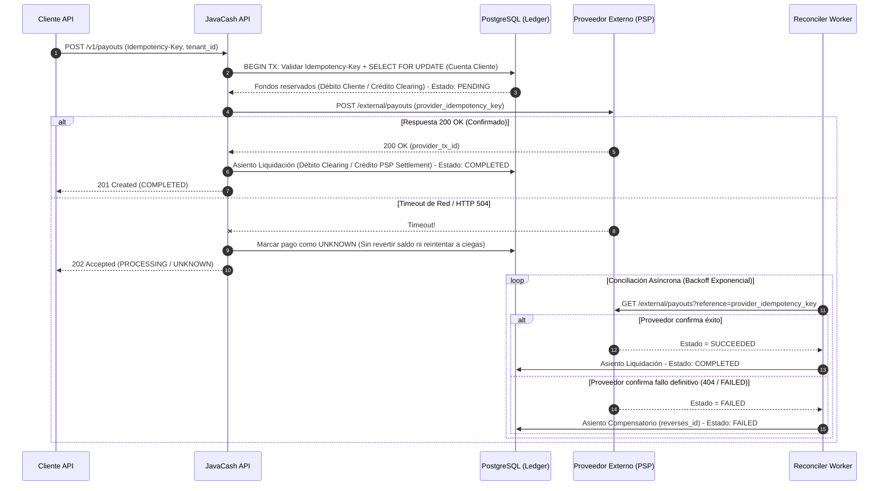

# RFC-0001: Motor de Pagos Resiliente con Idempotencia y Manejo de Estado `unknown`

- **Título:** Flujo de Pagos Salientes (Payouts) Resiliente a Timeouts e Idempotente
- **Responsable:** Equipo de Plataforma & Pagos JavaCash
- **Estado:** En Revisión (Draft)
- **Fecha:** 2026-10-20

---

## 1. Problema y Objetivo de Negocio
Cuando JavaCash instruye un pago o dispersión hacia un proveedor externo (ej. riel bancario o procesador SPEI/ACH/PIX), las fallas de red o timeouts HTTP dejan la transacción en un estado incierto: **no sabemos si el proveedor procesó el cargo o no**.
- Si el sistema reintenta automáticamente a ciegas tras un timeout, se corre el riesgo crítico de **duplicar el envío de dinero** (pérdida financiera directa).
- Si el sistema revierte el saldo inmediatamente tras un timeout y el proveedor sí procesó el pago, el cliente puede volver a gastar esos fondos (doble gasto).

**Objetivo:** Diseñar un flujo de pagos salientes 100% idempotente que retenga los fondos en una cuenta transitoria (`clearing/in-transit`), maneje explícitamente el estado `unknown` ante timeouts y concilie con el proveedor externo antes de confirmar o revertir el asiento contable.

---

## 2. Diseño Propuesto

### Diagrama de Arquitectura y Flujo Transaccional

### Máquina de Estados de la Transacción
1. `PENDING`: Fondos verificados y movidos atómicamente de la cuenta disponible del cliente a la cuenta `clearing_outbound` del `tenant_id`.
2. `UNKNOWN`: El llamado al proveedor externo sufrió un timeout o error de transporte indeterminado. Los fondos permanecen retenidos en `clearing_outbound`. **Prohibido reintentar el `POST` sin consulta previa**.
3. `COMPLETED`: Confirmado por respuesta síncrona, webhook verificado o consulta del `Reconciler Worker`. Se mueve el saldo de `clearing_outbound` a `psp_settlement`.
4. `FAILED`: El proveedor confirma que la operación no existió o fue rechazada. Se ejecuta un asiento compensatorio (`reverses_id`) devolviendo los fondos de `clearing_outbound` a la cuenta disponible del cliente.

---

## 3. Impacto Financiero y Contable (Ledger)

Todos los montos se expresan en enteros (`BIGINT`, unidad menor).

| Fase | Cuenta Débito | Cuenta Crédito | Monto (`BIGINT`) | Notas de Inmutabilidad |
| :--- | :--- | :--- | :--- | :--- |
| **1. Reserva (`PENDING`)** | `client_available:{tenant_id}` | `clearing_outbound:{tenant_id}` | `amount_cents` | En transacción atómica con `SELECT ... FOR UPDATE`. |
| **2a. Éxito (`COMPLETED`)** | `clearing_outbound:{tenant_id}` | `psp_settlement:{tenant_id}` | `amount_cents` | Nuevo asiento contable al confirmar con el PSP. |
| **2b. Reversión (`FAILED`)** | `clearing_outbound:{tenant_id}` | `client_available:{tenant_id}` | `amount_cents` | Asiento compensatorio con `reverses_id` apuntando al asiento de Fase 1. |

---

## 4. Seguridad y Cumplimiento (BOLA, Tenant, AML)
- **Aislamiento Multi-tenant (Prevención BOLA):** Todas las consultas e inserciones en `payouts`, `journal_entries` y `idempotency_keys` incluyen obligatoriamente `WHERE tenant_id = :authenticated_tenant_id`.
- **Idempotencia Externa:** Todo request `POST /v1/payouts` sin header `Idempotency-Key` es rechazado con `400 Bad Request`. Si se reutiliza la misma clave con diferente payload, se devuelve `422 Unprocessable Entity`.
- **Seguridad en Webhooks y Logs:**
  - Validación de firma criptográfica HMAC-SHA256 y timestamp en webhooks entrantes del PSP.
  - Enmascaramiento de CLABE/IBAN/PAN y datos PII en todos los logs estructurados.
- **Prevención de Lavado de Dinero (AML):** Antes de pasar a `PENDING`, se evalúan límites transaccionales acumulados por `tenant_id` y listas restrictivas.

---

## 5. Plan de Despliegue y Reversión (Rollback)
- **Despliegue:**
  1. Aplicar migraciones de base de datos aditivas (tabla `payouts` con estado `UNKNOWN` e índice único `(tenant_id, idempotency_key)`).
  2. Desplegar `Reconciler Worker` en modo lectura/monitoreo.
  3. Habilitar el endpoint mediante *feature flag* gradual por `tenant_id` en `staging` y luego en `production`.
- **Plan de Rollback:**
  1. Apagar el *feature flag* para detener nuevos `POST /v1/payouts`.
  2. Mantener activo el `Reconciler Worker` hasta drenar cualquier transacción en estado `UNKNOWN` o `PENDING`.
  3. **Nunca eliminar ni truncar tablas del Ledger**; cualquier saldo retenido se libera exclusivamente vía asientos compensatorios (`reverses_id`).

---

## 6. Alternativas Descartadas
1. **Reintentos automáticos HTTP en el cliente REST ante Timeouts:**
   - *Por qué se descartó:* Si el proveedor externo no soporta idempotencia estricta o si la clave expira, un reintento a ciegas produce doble dispersión de fondos.
2. **Descontar el saldo recién cuando el proveedor responde `200 OK`:**
   - *Por qué se descartó:* Permite ataques de concurrencia donde múltiples peticiones simultáneas leen el mismo saldo antes de que el proveedor responda, sobregirando la cuenta del tenant.
